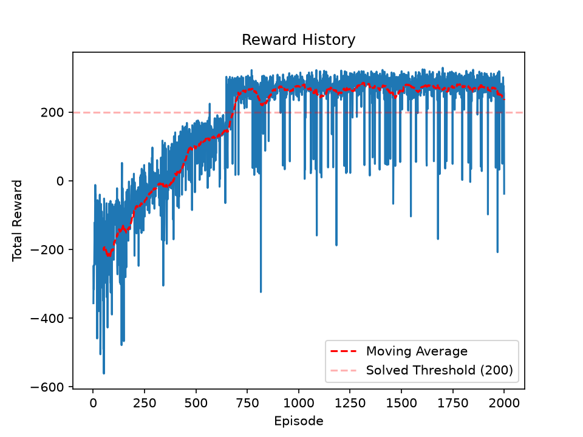

# rl-from-scratch

Reinforcement learning algorithms written from scratch in PyTorch, with no RL libraries. Gymnasium supplies only the environments. The repo starts with a policy gradient method on CartPole-v1 and ends with PPO on LunarLander-v3.

## Files

- `cartpole_reinforce.py`: Policy gradient with a learned value baseline (actor-critic style) on CartPole-v1. Shared network with policy and value heads, Monte Carlo returns, one update per episode, 1500 episodes, then 3 rendered demo episodes.
- `lunar_lander_ppo.py`: PPO with a clipped surrogate objective on LunarLander-v3. Trains for 2000 episodes, saves a reward plot, then runs 1 rendered demo episode.
- `lunar_lander_reward.png`: Reward curve from one training run of `lunar_lander_ppo.py`.
- `requirements.txt`: Pinned Python dependencies.

## How to run

LunarLander needs `box2d-py`, which builds from source and needs SWIG. Install SWIG first, for example on macOS:

    brew install swig

Then:

    python -m venv .venv
    source .venv/bin/activate
    pip install -r requirements.txt
    python lunar_lander_ppo.py

When training finishes, the script saves `lunar_lander_reward.png` and opens the plot in a window. The demo episode starts after you close that window.

To run the CartPole script:

    python cartpole_reinforce.py

## LunarLander PPO implementation

All values below come from `lunar_lander_ppo.py`.

- **Network:** Shared backbone of two 64-unit linear layers with LeakyReLU. Separate linear heads for policy logits (4 actions) and state value.
- **Returns:** Discounted Monte Carlo returns, gamma 0.99, scaled by 1/100. No bootstrapping. Hitting the time limit is treated the same as termination.
- **Advantage:** Return minus the value estimate, normalized over the whole batch. Each gradient epoch recomputes it with the current value head.
- **Policy loss:** Clipped surrogate objective with epsilon 0.2, taking the minimum of the clipped and unclipped terms. Old log-probabilities are recorded during collection.
- **Value loss:** MSE against the scaled returns, weight 0.5. No entropy bonus.
- **Optimizer:** AdamW, lr 3e-4, weight decay 1e-4.
- **Batching:** 8 episodes per batch, reused for 50 full-batch gradient steps (no minibatches). The batch is then discarded.
- **Training vs demo:** Training samples actions from the policy. The demo picks the greedy action, except that it forces action 0 (do nothing) when both leg-contact flags are 1.

## Results

Settings for this run: batch of 8 episodes, 50 epochs per batch, lr 3e-4, 2000 episodes.

The 50-episode moving average crosses the solved threshold of 200 around episode 680. After that it mostly stays between about 250 and 280, with a dip to about 220 near episode 800. Training samples its actions, so the raw per-episode curve has dips even after the agent has learned to land.

Runs are not seeded, so exact numbers vary between runs.

## Development notes

Each row is a single run of an earlier version of the code. Those versions are not in the repo.

| Version | Change | Outcome |
|---|---|---|
| 1 | Actor-critic, one update per batch | Touched down, then hovered until the time limit |
| 2 | 20 gradient epochs per batch, no clipping | Stuck, never improved |
| 3 | Ratio clipping only, lr 3e-3 | Average reached about 155, collapsed near episode 1000 |
| 4 | Ratio clipping only, lr 3e-4 | Slower start, peaked about 180, no collapse |
| 5 | Full PPO objective, lr 3e-4, batch 4, 20 epochs | Crossed 200 near episode 950, then stayed between about 210 and 257 |
| 6 | Full PPO objective, lr 3e-4, batch 8, 50 epochs | See Results |

1. With one gradient step per batch, the agent learned to touch down but then hovered until the 1000-step time limit. This was a local optimum caused by poor exploration.
2. Reusing each batch for 20 epochs without clipping stalled training. After the first few steps, the data no longer matched the updated policy.
3. Clamping the probability ratio to [0.8, 1.2], without the minimum against the unclipped term, reached a 50-episode average of about 155. It collapsed around episode 1000 and did not recover.
4. The same objective with lr 3e-4 started slower and peaked around 180 without collapsing.
5. The full clipped objective (the minimum of the clipped and unclipped terms) crossed 200 around episode 950 and stayed between about 210 and 257.
6. The final settings are the ones in the current code. See Results.

In several runs, the reward jumped by about 100 at once. Each jump matched the agent learning to land and shut off its engines instead of hovering, which collects the landing bonus. The moving average in the Results plot shows a jump like this between episodes 650 and 700.

## Next steps

- Continuous action spaces with a Gaussian policy, starting with MuJoCo Reacher-v5.
- A custom robot arm environment.
