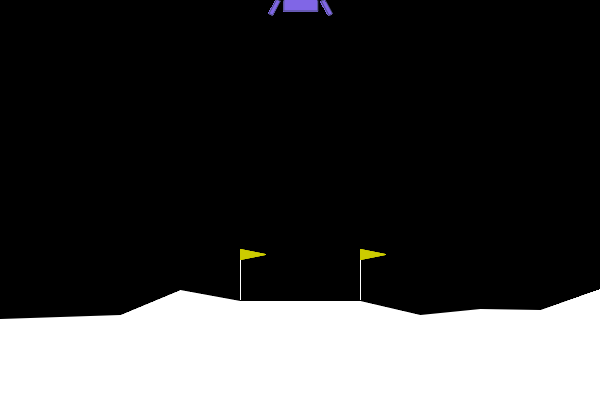
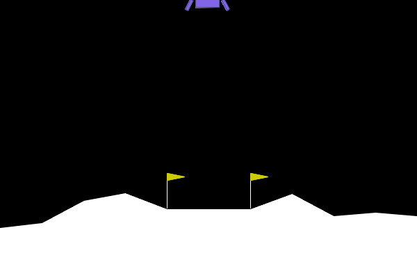
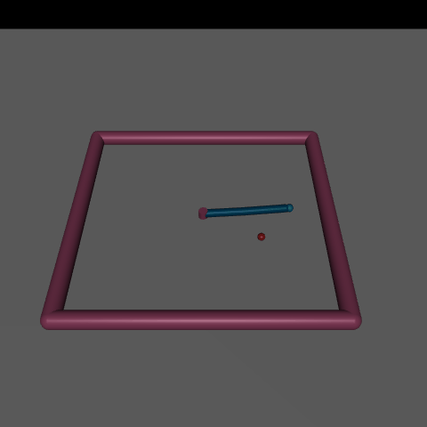
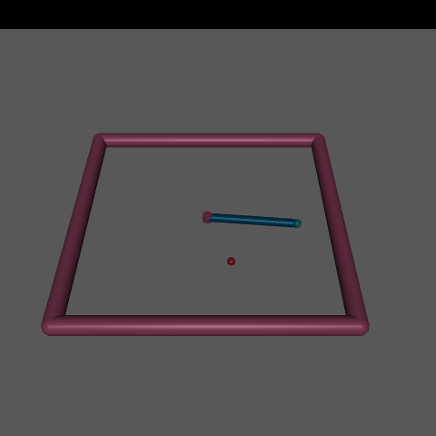
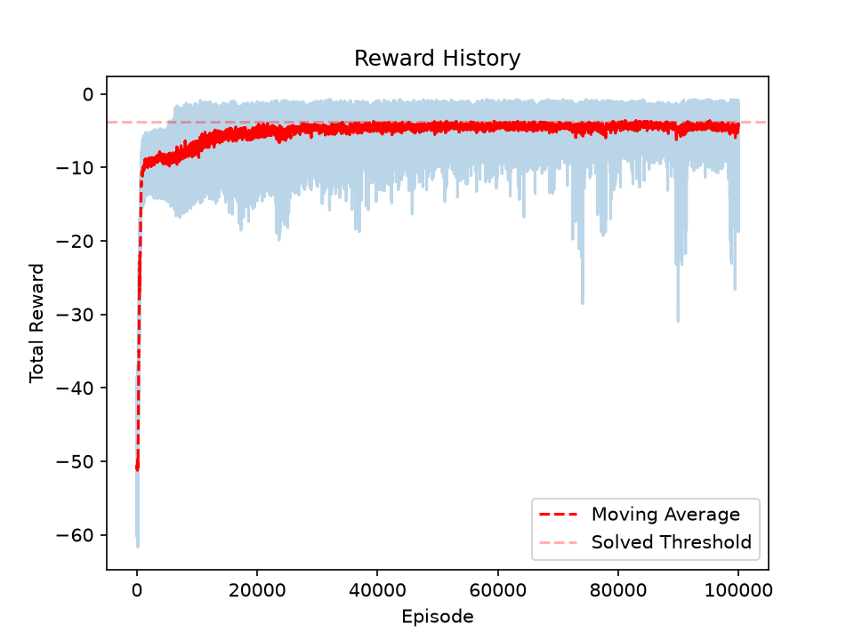

# rl-from-scratch

Reinforcement learning algorithms written from scratch in PyTorch, with no RL libraries. Gymnasium supplies only the environments. The repo starts with a policy gradient method on CartPole-v1, moves to PPO on LunarLander-v3, and then extends PPO to continuous actions with a Gaussian policy on MuJoCo Reacher-v5.

## Files

- `cartpole_reinforce.py`: Policy gradient with a learned value baseline (actor-critic style) on CartPole-v1. Shared network with policy and value heads, Monte Carlo returns, one update per episode, 1500 episodes, then 3 rendered demo episodes.
- `lunar_lander_ppo.py`: PPO with a clipped surrogate objective on LunarLander-v3. Records an episode before training, trains for 2000 episodes, saves the weights and a reward plot, then records an episode after training.
- `lunar_lander_before_training.gif`, `lunar_lander_after_training.gif`: Episodes recorded by `lunar_lander_ppo.py` before and after training (every second frame).
- `lunar_lander_reward.png`: Reward curve from the same run.
- `lunar_lander_ppo.pt`: Trained weights from the same run, saved as a PyTorch `state_dict` for `PolicyNetwork(input_dim=8, output_dim=4)`.
- `reacher_ppo.py`: PPO with a Gaussian policy for continuous torques on Reacher-v5. Records 5 episodes before training, trains for 100,000 episodes, saves the weights and a reward plot, then records 5 episodes after training.
- `evaluate_reacher.py`: Loads `reacher_ppo.pt`, runs 20 greedy episodes on Reacher-v5, and prints the mean and standard deviation of the episode rewards.
- `reacher_before_training.gif`, `reacher_after_training.gif`: 5 episodes each, recorded by `reacher_ppo.py` before and after training.
- `reacher_ppo_reward.png`: Reward curve from the same run.
- `reacher_ppo.pt`: Trained weights from the same run, including the observation normalization stats, for `PolicyNetwork(input_dim=11, output_dim=4)` in `reacher_ppo.py`.
- `requirements.txt`: Pinned Python dependencies.

## How to run

LunarLander needs `box2d-py`, which builds from source and needs SWIG. Install SWIG first, for example on macOS:

    brew install swig

Then:

    python -m venv .venv
    source .venv/bin/activate
    pip install -r requirements.txt
    python lunar_lander_ppo.py

`lunar_lander_ppo.py` runs these steps in order:

1. Records one episode with the untrained network to `lunar_lander_before_training.gif`.
2. Trains for 2000 episodes, printing the 50-episode average reward every 50 episodes.
3. Saves the weights to `lunar_lander_ppo.pt`.
4. Saves `lunar_lander_reward.png` and opens the plot in a window.
5. After you close the plot window, records one episode with the trained network to `lunar_lander_after_training.gif`.

`python reacher_ppo.py` follows the same steps for Reacher-v5, with 100,000 training episodes and 5 recorded episodes per GIF. It also prints the reward of each greedy episode it records. To evaluate the saved Reacher model without retraining:

    python evaluate_reacher.py

Running a training script overwrites its result files in the repo.

To run the CartPole script:

    python cartpole_reinforce.py

## LunarLander-v3

  
  

**Left: before training. Right: after training.** The left GIF shows the untrained network with sampled actions. It drifts sideways and hits the ground within about 75 steps. The right GIF shows the trained network with greedy actions. It lands between the flags and comes to rest. Each GIF shows a single episode from the same run as the reward plot below.

### Implementation

All values below come from `lunar_lander_ppo.py`.

- **Network:** Shared backbone of two 64-unit linear layers with LeakyReLU. Separate linear heads for policy logits (4 actions) and state value.
- **Returns:** Discounted Monte Carlo returns, gamma 0.99, scaled by 1/100. No bootstrapping. Hitting the time limit is treated the same as termination.
- **Advantage:** Return minus the value estimate, normalized over the whole batch. Each gradient epoch recomputes it with the current value head.
- **Policy loss:** Clipped surrogate objective with epsilon 0.2, taking the minimum of the clipped and unclipped terms. Old log-probabilities are recorded during collection.
- **Value loss:** MSE against the scaled returns, weight 0.5. No entropy bonus.
- **Optimizer:** AdamW, lr 3e-4, weight decay 1e-4.
- **Batching:** 8 episodes per batch, reused for 50 full-batch gradient steps (no minibatches). The batch is then discarded.
- **Action selection:** Training and the before-training GIF sample actions from the policy. The after-training GIF takes the greedy (argmax) action.

### Results

Settings for this run: batch of 8 episodes, 50 epochs per batch, lr 3e-4, 2000 episodes.

The 50-episode moving average (dashed red) crosses the solved threshold of 200 around episode 700. After that it mostly stays between about 200 and 265, with dips to about 175 near episode 900 and about 185 near episode 1750. The raw per-episode rewards (light blue) still dip often after the agent has learned to land, because training samples its actions.

Runs are not seeded, so exact numbers vary between runs.

### Development notes

Each row is a single run of an earlier version of the code. Those versions are not in the repo.

| Version | Change | Outcome |
|---|---|---|
| 1 | Actor-critic, one update per batch | Touched down, then hovered until the time limit |
| 2 | 20 gradient epochs per batch, no clipping | Stuck, never improved |
| 3 | Ratio clipping only, lr 3e-3 | Average reached about 155, collapsed near episode 1000 |
| 4 | Ratio clipping only, lr 3e-4 | Slower start, peaked about 180, no collapse |
| 5 | Full PPO objective, lr 3e-4, batch 4, 20 epochs | Crossed 200 near episode 950, then stayed between about 210 and 257 |
| 6 | Full PPO objective, lr 3e-4, batch 8, 50 epochs | See Results |

1. With one gradient step per batch, the agent learned to touch down but then hovered until the 1000-step time limit. This was a local optimum caused by poor exploration.
2. Reusing each batch for 20 epochs without clipping stalled training. After the first few steps, the data no longer matched the updated policy.
3. Clamping the probability ratio to [0.8, 1.2], without the minimum against the unclipped term, reached a 50-episode average of about 155. It collapsed around episode 1000 and did not recover.
4. The same objective with lr 3e-4 started slower and peaked around 180 without collapsing.
5. The full clipped objective (the minimum of the clipped and unclipped terms) crossed 200 around episode 950 and stayed between about 210 and 257.
6. The final settings are the ones in the current code. See Results.

In several runs, the reward jumped by about 100 at once. Each jump matched the agent learning to land and shut off its engines instead of hovering, which collects the landing bonus. The moving average in the Results plot shows a jump like this between episodes 650 and 750.

## Reacher-v5

  
  

**Left: before training. Right: after training.** Each GIF shows 5 episodes of 50 steps from the same run as the reward plot below. Before training, the network samples actions and the arm moves without reaching for the red target. After training, the network takes the greedy (mean) action, and the fingertip moves to the target and stays there.

### Implementation

All values below come from `reacher_ppo.py`. The PPO update has the same structure as LunarLander: Monte Carlo returns, advantage normalized per batch and recomputed each epoch, full-batch updates, no entropy bonus.

- **Policy:** Gaussian over 2 continuous joint torques. The network outputs 4 numbers: a mean and a raw sigma for each torque. Sigma is softplus(raw) + 0.05, so it never drops below 0.05. The log-probability of an action is the sum over both torques.
- **Action clipping:** The raw sample and its log-probability are stored for the update. Only a copy clipped to [-1, 1] is sent to the environment.
- **Observation normalization:** Per-feature mean and std are computed from 2000 steps of random-action rollouts before training. They are stored as model buffers, so they are saved in `reacher_ppo.pt`.
- **Time input:** A "steps remaining / 50" feature is appended to the 10-dimensional observation (11 inputs in total). It lets the value estimate account for the time left in the 50-step episode.
- **Network:** Shared backbone of three 64-unit linear layers with LeakyReLU. Separate linear heads for the policy outputs and state value.
- **Returns:** Discounted Monte Carlo returns, gamma 0.99, scaled by 1/10.
- **Losses:** Clipped surrogate objective with epsilon 0.2. Value loss weight 0.5.
- **Optimizer:** AdamW, lr 3e-4, weight decay 1e-3.
- **Batching:** 10 episodes per batch, reused for 5 gradient steps. 100,000 episodes in total (5M environment steps).
- **Seeding:** `torch.manual_seed(42)`. The environment is not seeded, so runs still vary.

### Results

Settings for this run: batch of 10 episodes, 5 epochs per batch, lr 3e-4, 100,000 episodes.

`evaluate_reacher.py` runs the saved model greedily for 20 episodes (environment seed 0) and scores **-4.20 +/- 2.05**. Gymnasium registers a reward threshold of -3.75 for Reacher-v5 (the dashed line in the plot), so this model does not reach it.

The training curve ends at about -4.5 to -5. Training samples actions from the Gaussian, so that curve includes exploration noise. The greedy evaluation is the fair number to compare against the threshold. The 50-episode moving average stopped improving around episode 40,000.

### Development notes

Each row is a single run of an earlier version of the code. Those versions are not in the repo. All runs used 2,000 episodes (100k steps) unless stated otherwise.

| Version | Change | Outcome |
|---|---|---|
| 1 | First version | Training reward plateaued around -9 to -10, sigma collapsed to about 0.01 |
| 2 | Sigma floor of 0.05 | Exploration noise kept, same plateau |
| 3 | Observation normalization | Faster early learning, same plateau |
| 4 | Steps-remaining input | Same plateau |
| 5 | Reference: Stable-Baselines3 PPO, default settings, 100k steps | -7.2 +/- 2.1 over 20 greedy episodes |
| 6 | 50,000 episodes | Training reward around -4.5 |
| 7 | 100,000 episodes | See Results |

1. The first version plateaued at a training reward around -9 to -10, and sigma collapsed to about 0.01.
2. A sigma floor of 0.05 kept exploration noise but did not move the plateau.
3. The arm learned to fold up and stay near the center. That strategy is decent on average and ignores the target. Raw joint velocities were roughly 10 to 100 times larger than the target features, so observation normalization was added. Early learning got faster, but the plateau stayed.
4. The steps-remaining input was added so the critic could tell early steps from late ones. The plateau stayed at this budget.
5. As a reference check, Stable-Baselines3 PPO with default settings scored -7.2 +/- 2.1 over 20 greedy episodes at 100k steps. That is about the same as this agent at the same budget, so the plateau was mostly a lack of training, not a bug. Stable-Baselines3 is not used anywhere in this repo.
6. Training for 50,000 episodes reached a training reward around -4.5.
7. The final run used the settings in the current code. See Results.

## Next steps

- Generalized advantage estimation (GAE) for better advantage estimates.
- Minibatch updates.
- An entropy bonus.
- A custom MuJoCo robot arm environment.
